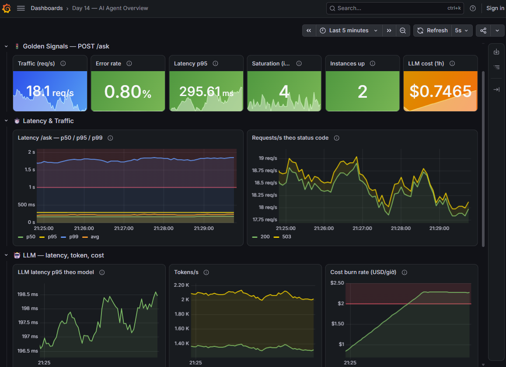
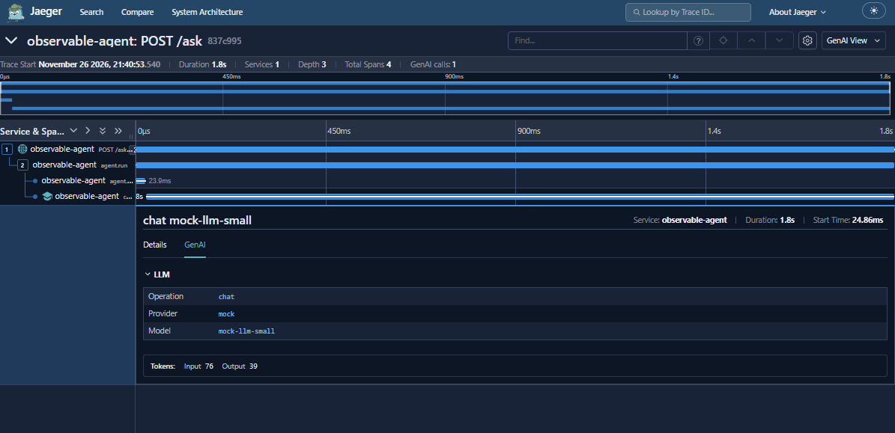
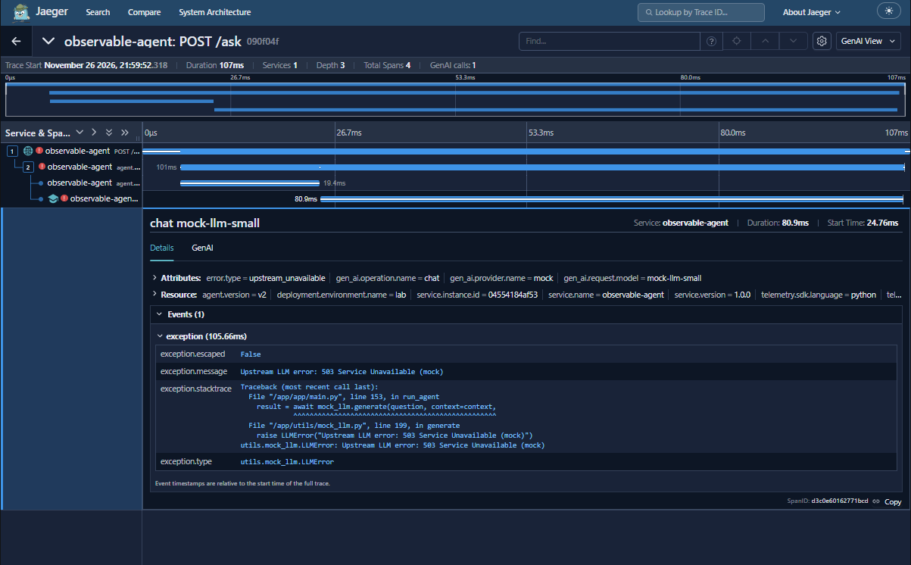
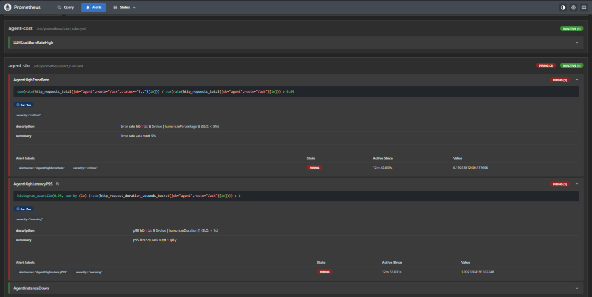

# Benchmark & Observability Report — Day 14

> Mọi con số lấy từ report JSON trong `reports/`, CSV trong `benchmark-results/` và screenshot trong `screenshots/`.

**Họ tên:** 
Tào Quang Vinh

**Ngày chạy:** 26/11/2026

**Môi trường:** Windows 11, WSL2 Ubuntu 24.04 (12 CPU, 7.6 GiB RAM), Intel Core i5-11400H, Python 3.12.3, Docker 29.8.2

---

## 1. SLO của agent

| SLI | SLO | Lý do chọn ngưỡng này |
|---|---|---|
| p95 latency `/ask` | < 500 ms | p95 đo được 218–277 ms ở concurrency 1–50, ngưỡng chừa khoảng gấp đôi; ở concurrency 100 (637 ms) thì vi phạm, đúng lúc request bắt đầu phải xếp hàng |
| Error rate `/ask` | < 2 % | Mock LLM mặc định lỗi khoảng 1 %, vượt gấp đôi mức nền mới coi là bất thường |
| Accuracy trên golden dataset | ≥ 85 % | Cho phép tối đa 3/23 câu sai (v2 ban đầu đạt 91,3 %), kèm điều kiện không có regression |

### Ghi chú Exercise 7.1: metrics

- Counter: `http_requests_total` (chỉ tăng). Gauge: `agent_in_flight_requests` (lên xuống). Histogram: `http_request_duration_seconds` (đếm theo bucket `le`, dùng để tính percentile).
- Label `route` dùng mẫu route (URL lạ gộp vào `unmatched`). Nếu dùng `request.url.path`, bot quét hàng nghìn URL sẽ tạo hàng nghìn time series và làm Prometheus tốn RAM.
- Đã thêm histogram `agent_question_length_chars`. Dùng histogram thay vì label độ dài để tránh cardinality cao.

---

## 2. Benchmark hiệu năng (develop, `load_test.py`)

### 2.1 Concurrency vs latency (agent v2)

| Concurrency | RPS | p50 (ms) | p95 (ms) | p99 (ms) | Error rate | SLO |
|---|---|---|---|---|---|---|
| 1 | 4.11 | 189.2 | 218.2 | 1695.3 | 1.67 % | PASS |
| 10 | 38.26 | 190.3 | 220.0 | 1703.9 | 0.00 % | PASS |
| 50 | 108.18 | 201.1 | 277.3 | 1706.4 | 1.33 % | PASS |
| 100 | 109.16 | 250.1 | 637.3 | 1728.8 | 3.00 % | FAIL (p95, error rate) |

Mỗi mức 300 request, `MOCK_SLOW_RATE` và `MOCK_ERROR_RATE` mặc định.

**Nhận xét:** RPS **không** tăng tuyến tính theo concurrency.

- Concurrency 1 → 10: RPS tăng 9,3 lần, gần tuyến tính, latency hầu như không đổi. Ở mức 1, RPS xấp xỉ 1 / latency trung bình (1 / 0,243 s ≈ 4,1).
- 10 → 50: concurrency tăng 5 lần, RPS chỉ tăng 2,8 lần.
- 50 → 100: RPS đứng ở khoảng 108–109, trong khi p50 tăng từ 201 lên 250 ms và p95 từ 277 lên 637 ms. Thêm request đồng thời chỉ làm chúng chờ lâu hơn, tức đã bão hoà.
- Nguyên nhân có thể: agent chạy một process (một event loop) và load generator chạy chung máy. Ở mức 50 và 100, mỗi lần đo chỉ kéo dài khoảng 2,8 s nên vài request chậm 1,7 s cũng kéo RPS xuống; muốn kết luận chắc hơn cần đo lâu hơn.
- Lỗi đều là 503 do mock LLM sinh ngẫu nhiên, không phụ thuộc tải theo code. Với 300 mẫu, tỉ lệ dao động mạnh (0 % đến 3 %), nên việc FAIL error rate ở mức 100 chưa đủ để nói do tải.

### 2.2 Tail latency

| `MOCK_SLOW_RATE` | avg (ms) | p95 (ms) | p99 (ms) |
|---|---|---|---|
| 0 | 189.3 | 218.4 | 226.2 |
| 0.03 (mặc định) | 254.0 | 224.1 | 1708.4 |
| 0.1 | 374.2 | 1690.0 | 1711.9 |

Mỗi lần 300 request, concurrency 20.

**Nhận xét:**

- **p99** nhạy nhất: chỉ 3 % request chậm đã đẩy p99 từ 226 lên 1708 ms (gấp 7,6 lần), trong khi avg chỉ tăng 65 ms và p95 gần như không đổi (vì tỉ lệ chậm nhỏ hơn 5 %).
- Ở 10 % (lớn hơn 5 %), p95 cũng nhảy lên 1690 ms (gấp 7,7 lần), avg mới tăng khoảng 2 lần. p50 vẫn quanh 189–194 ms ở cả ba mức.
- Không nên đặt SLO theo average: average trộn số ít request rất chậm vào số đông request nhanh. Ở mức 3 %, avg 254 ms trông ổn trong khi cứ khoảng 33 người có 1 người chờ hơn 1,5 s. SLO theo p95 / p99 phản ánh đúng nhóm người dùng bị chậm.

---

## 3. Benchmark chất lượng (develop, `eval/run_eval.py`)

| Chỉ số | Agent v1 | Agent v2 | Agent v2 (sau khi sửa KB) |
|---|---|---|---|
| Accuracy | 4.3 % (1/23) | 91.3 % (21/23) | 100 % (23/23) |
| Avg tokens / câu | 57.1 | 109.0 | 113.7 |
| Tổng cost (USD) | 0.000404 | 0.00076 | 0.00079 |
| Cost / câu đúng (USD) | 0.00040395 | 0.00003619 | 0.00003436 |
| Quality gate | FAIL (ngưỡng 80 %) | PASS (ngưỡng 80 %, không regression) | PASS (ngưỡng 100 %, không regression so với v2) |

**Những câu v2 trả lời sai ban đầu và cách bạn sửa:**

| ID | Keyword bị thiếu | Bạn đã sửa gì |
|---|---|---|
| `security-02` | `token`, `hết hạn`, `chữ ký` | Thêm tài liệu so sánh API key và JWT vào `KNOWLEDGE_BASE`, từ khoá kích hoạt `jwt` |
| `scaling-03` | `cpu`, `memory`, `custom metrics` | Thêm tài liệu về Kubernetes HPA, từ khoá kích hoạt `hpa`, `kubernetes`, `autoscal` |

Chỉ sửa `develop/utils/mock_llm.py`, không sửa `golden_dataset.jsonl`.

**Nhận xét về trade-off chất lượng / chi phí / latency giữa v1 và v2:**

- **Chất lượng:** retrieval đưa accuracy từ 4,3 % lên 91,3 %, cải thiện 20 câu, không regression.
- **Chi phí:** v2 dùng khoảng 1,9 lần token mỗi câu và tổng cost cao hơn 1,9 lần, nhưng **cost mỗi câu đúng rẻ hơn khoảng 11 lần**. So theo cost mỗi câu thì v1 có vẻ rẻ, dù phần lớn tiền trả cho câu trả lời sai.
- **Latency:** p50 trong eval tăng từ 157 lên 195 ms (thêm bước retrieval và prompt dài hơn). p95 của eval (185 so với 1537 ms) không dùng để kết luận: mẫu chỉ 23 câu, vài request chậm ngẫu nhiên đã đổi p95 (lần chạy v2 sau khi sửa KB cho p95 215,8 ms với cùng pipeline). Latency phải đọc từ load test.
- **Sau khi sửa KB:** thêm 2 câu đúng, token mỗi câu tăng từ 109,0 lên 113,7, cost mỗi câu đúng giảm nhẹ.

**Quality gate trong CI** (`.github/workflows/eval.yml`):

- Mỗi pull request: chạy agent v2, rồi `run_eval.py --min-accuracy 0.85 --baseline reports/eval_v2_fixed.json`.
- `run_eval.py` trả **exit code 1** khi accuracy dưới ngưỡng hoặc có câu trước đúng nay sai. Bước CI fail nên job đỏ.
- Để chặn merge thật sự, bật branch protection cho `main` và yêu cầu job `eval` phải pass.

Kiểm chứng exit code ở máy local (cho agent v1 chạy với baseline là v2 đã sửa):

```text
$ python eval/run_eval.py --url http://localhost:8001 --baseline reports/eval_v2_fixed.json
  ✨ Câu được cải thiện : 0
  ⚠️  Câu bị regression : 22
  Quality gate (accuracy ≥ 80%, không regression): ❌ FAIL
exit code: 1
```

Lệnh tương tự cho v2 đã sửa (baseline `eval_v2.json`, `--min-accuracy 1.0`) trả exit code 0.

---

## 4. Observability stack (production)

### 4.1 Screenshot

- [x] Dashboard Grafana khi đang có tải (thấy rõ Golden Signals)
- [x] Một trace chậm trong Jaeger (thấy span nào chiếm thời gian)
- [x] Một trace lỗi trong Jaeger (có event `exception`)
- [x] Trang Alerts của Prometheus với ít nhất 1 alert đang **firing**







#### Trả lời Exercise 7.4

Số tại thời điểm chụp dashboard (26/11/2026 khoảng 21:29, Locust 30 user, 2 instance, cửa sổ 1 phút).

1. **p95 và avg:** p95 = 295.6 ms, avg khoảng 240 ms, p50 khoảng 178 ms, p99 khoảng 1857 ms. p95 chỉ cao hơn avg khoảng 55 ms, nhưng p99 gấp khoảng 7,7 lần avg: đa số request nhanh, một phần nhỏ rất chậm (`MOCK_SLOW_RATE=0.03`, dưới 5 % nên p95 không thấy). Avg lớn hơn p50 cũng vì đuôi chậm này kéo lên. (p95 của Grafana là ước lượng nội suy từ histogram bucket nên không trùng khít số Locust đo.)
2. **Chia tải:** Nginx chia gần đều, 9.14 và 8.98 request/s cho hai instance.
3. **Input tokens/s lớn hơn output:** khoảng 1317 so với 701 token/s (biểu đồ vẽ chồng, đường trên là tổng), tức mỗi request khoảng 73 token vào và 39 token ra. Prompt gồm system prompt, tài liệu retrieve được và câu hỏi, còn câu trả lời của mock chỉ là tài liệu đó, nên input luôn dài hơn. Output vẫn chiếm khoảng 68 % chi phí vì đơn giá output của `mock-llm-small` gấp 4 lần input.
4. **`curl http://localhost:8080/metrics`:** trả **404** từ Nginx (`location = /metrics { return 404; }`). Metric lộ lưu lượng và thông tin hệ thống nên không mở ra cổng public; Prometheus scrape trực tiếp từng agent trong mạng Docker nội bộ.

### 4.2 Thí nghiệm "phá hệ thống"

| # | Thay đổi | Alert nào firing | Thời gian từ lúc đổi → firing | Panel nào phản ánh rõ nhất |
|---|---|---|---|---|
| A | `MOCK_ERROR_RATE=0.2` | `AgentHighErrorRate` | 89 s (pending ở 28 s) | Error rate: 1.9 % → 20.9 % |
| B | `MOCK_SLOW_RATE=0.3` | `AgentHighLatencyP95` | 144 s (pending ở 23 s) | Latency p95: 0.29 → 1.90 s (avg 0.23 → 0.60 s, p50 0.17 → 0.20 s) |
| C | `LLM_MODEL=mock-llm-large` | `LLMCostBurnRateHigh` | 186 s (pending ở 69 s) | Cost burn rate: 6.5 USD/giờ lúc firing, 9.6 lúc kết thúc (cửa sổ 5 phút nên còn tăng). Cost mỗi request 0.0000347 → 0.000579 (gấp khoảng 17), token không đổi. p50 0.17 → 0.41 s, p95 0.29 → 0.65 s |
| D | `docker pause` 1 instance | `AgentInstanceDown` | 45 s (pending ở 15 s) | Instances up: 2 → 1. Locust có thêm 13 lỗi 504, trong khi error rate phía agent vẫn 1.3 – 1.8 % |
| E | `AGENT_VERSION=v1` | Không có | — | Bảng phiên bản đổi sang v1. Token mỗi request 74/39 → 36/20, cost mỗi request giảm một nửa, không còn lần retrieval nào |

**Cách đo:** script ghi thời điểm đổi cấu hình (T0), đọc `/api/v1/alerts` mỗi 5 giây và lưu vào `benchmark-results/chaos_*.txt` (giờ trong log là UTC, giờ Việt Nam cộng 7). Thời gian tính từ trước khi chạy lệnh `docker compose up -d` hoặc `docker pause`, nên gồm cả thời gian tạo lại container. Số theo mỗi request nằm trong `benchmark-results/prometheus_chaos.txt`.

- A và B chạy **cùng lúc**, 30 user. C, D, E chạy 10 user, giữa các lượt khôi phục về mặc định.
- `LLMCostBurnRateHigh` đã firing **trước** thí nghiệm A/B: tải bình thường 30 user đã tốn 2.28 USD/giờ, vượt ngưỡng 2 USD. Nó tự tắt ở giây 94 vì request lỗi không tốn token và request chậm làm thông lượng giảm. Phải hạ còn 10 user mới đo được thí nghiệm C.
- Ở C, p95 chỉ 0.65 s, dưới ngưỡng 1 s, nên alert latency không firing.
- Ở D, lỗi 504 xảy ra tại Nginx nên metric của agent không đếm được.
- Ở E, `AgentHighLatencyP95` vào `pending` hai lần nhưng không firing. Nguyên nhân là 3 % request chậm mặc định: với khoảng 6 request/s, tỉ lệ chậm trong cửa sổ 1 phút dao động quanh 5 %, p95 nhảy giữa 0.2 và 1.5 s. `for: 2m` đã chặn báo động giả.
- Mỗi lần tạo lại container, `AgentInstanceDown` pending vài giây (`for: 30s` chặn được) và Locust nhận thêm khoảng 60 – 80 lỗi 502 vì cả hai instance bị thay cùng lúc.



**Thí nghiệm E không làm alert nào firing. Bạn sẽ phát hiện loại sự cố này trong production bằng cách nào?**

Metric hạ tầng không biết câu trả lời đúng hay sai: v1 còn nhanh và rẻ hơn v2, trong khi accuracy ở Part 7 Bước 1 chỉ 4.3 %. Cần đo chất lượng:

1. **Trước khi deploy:** quality gate trong CI chạy golden dataset (ngưỡng 85 %, không regression), nên v1 bị chặn.
2. **Sau khi deploy:** định kỳ chạy golden dataset vào bản đang chạy, đẩy accuracy thành metric và đặt alert; lấy mẫu câu trả lời thật để chấm và thu phản hồi người dùng.
3. **Tín hiệu gián tiếp:** alert khi tỉ lệ số lần retrieval trên số lần gọi LLM tụt mạnh, hoặc token mỗi request đổi đột ngột. Rule phải xử lý được trường hợp metric biến mất, vì v1 không phát metric retrieval.

### 4.3 Debug bằng trace

Chọn 1 trace chậm nhất bạn tìm được:

- `trace_id`: `837c995774c9425fd7dcb66e2d2e9bca` (26/11/2026 21:40:53, chậm nhất trong 20 trace trên 1.5 s mà Jaeger trả về)
- Tổng thời gian: 1800.7 ms (span `POST /ask`)
- Span chiếm nhiều thời gian nhất: `chat mock-llm-small` (1774.2 ms, 98.5 %). `agent.retrieve_context` chỉ 23.9 ms (1.3 %). Vậy chậm là do lời gọi LLM (đuôi latency của mock), không phải do code của agent.
- Dòng log tương ứng (grep theo `trace_id`):

```json
{"ts": "2026-11-26T14:40:55.339270+00:00", "level": "INFO", "service": "observable-agent", "instance": "29237b20d988", "event": "llm_call", "trace_id": "837c995774c9425fd7dcb66e2d2e9bca", "span_id": "f68aad052c0dea32", "request_id": "2f10e8665a2a", "model": "mock-llm-small", "agent_version": "v2", "input_tokens": 76, "output_tokens": 39, "cost_usd": 3.5e-05, "llm_ms": 1692.0}
{"ts": "2026-11-26T14:40:55.340241+00:00", "level": "INFO", "service": "observable-agent", "instance": "29237b20d988", "event": "http_request", "trace_id": "837c995774c9425fd7dcb66e2d2e9bca", "span_id": "f68aad052c0dea32", "request_id": "2f10e8665a2a", "method": "POST", "route": "/ask", "status": 200, "ms": 1718.6}
```

Lưu ý khi đọc số: `llm_ms` trong log là độ trễ mà mock tính ra trước khi sleep, không phải số đo. `ms` của middleware (1718.6) thấp hơn thời lượng span (1800.7) khoảng 80 ms; hai bên dùng đồng hồ đo khác nhau, tôi chưa xác định được nguyên nhân phần chênh.

**Trace lỗi:** `090f04f54f515f72cdb2025b6f75782a` (26/11/2026 21:59:52)

- `POST /ask` mất 106.7 ms và trả 503; `agent.retrieve_context` 19.4 ms; `chat mock-llm-small` 80.9 ms.
- Span `chat mock-llm-small` có `error.type=upstream_unavailable` và event `exception`: `utils.mock_llm.LLMError: Upstream LLM error: 503 Service Unavailable (mock)`. `agent.run` và `POST /ask` cũng bị đánh dấu lỗi.
- Request lỗi ngắn hơn request thành công vì mock trả lỗi sau khoảng nửa độ trễ.

```json
{"ts": "2026-11-26T14:59:52.424869+00:00", "level": "INFO", "service": "observable-agent", "instance": "04554184af53", "event": "llm_error", "trace_id": "090f04f54f515f72cdb2025b6f75782a", "span_id": "eeeb680ac2f2b764", "request_id": "69f1cbd7d437", "error": "Upstream LLM error: 503 Service Unavailable (mock)"}
{"ts": "2026-11-26T14:59:52.425211+00:00", "level": "INFO", "service": "observable-agent", "instance": "04554184af53", "event": "http_request", "trace_id": "090f04f54f515f72cdb2025b6f75782a", "span_id": "eeeb680ac2f2b764", "request_id": "69f1cbd7d437", "method": "POST", "route": "/ask", "status": 503, "ms": 106.1}
```

---

## 5. Benchmark scaling (production, Locust headless, 100 users, 2 phút)

| Số instance | RPS | p50 (ms) | p95 (ms) | p99 (ms) | Failures |
|---|---|---|---|---|---|
| 1 | 59.66 | 190 | 240 | 1700 | 66 / 7146 (0.92 %) |
| 2 | 60.74 | 190 | 230 | 1700 | 80 / 7271 (1.10 %) |
| 3 | 59.37 | 190 | 220 | 1700 | 64 / 7113 (0.90 %) |

Số liệu là dòng `/ask` trong `benchmark-results/scale_<n>_stats.csv`. Dòng 2 instance là số đo thêm: ở lần đo này instance thứ hai chỉ xuất hiện sau khoảng 12 giây đầu (đang ramp-up).

Số liệu phía server, lấy từ Prometheus trên cùng ba lần đo (`benchmark-results/prometheus_scale.txt`):

| Số instance | Request mỗi instance (cửa sổ 110 s) | CPU mỗi instance (giới hạn 0.5 core) | Latency `/ask` trung bình | Latency LLM trung bình |
|---|---|---|---|---|
| 1 | 6784 | 0.176 | 231.4 ms | 208.3 ms |
| 2 | 3452 / 3454 | 0.103 | 229.8 ms | 207.8 ms |
| 3 | 2257 / 2242 / 2262 | 0.071 – 0.072 | 233.8 ms | 211.7 ms |

**Giải thích kết quả:** Scale **không** cải thiện đáng kể.

- RPS (59–61), p50 (190 ms), p99 (1700 ms) và latency trung bình gần như không đổi. p95 chênh 220–240 ms, mỗi cấu hình chỉ đo một lần và latency trung bình không giảm, nên không đủ để kết luận là nhờ scale.
- Nút thắt không nằm ở CPU của agent: 1 instance mới dùng khoảng 35 % giới hạn 0.5 core.
- Thời gian chủ yếu là chờ LLM: khoảng 208 ms trong 231 ms (90 %). Thêm instance không làm một lần gọi LLM nhanh hơn. p99 1700 ms đến từ `MOCK_SLOW_RATE=0.03`, tức đuôi latency của LLM.
- RPS bị giới hạn bởi phía tạo tải: 100 user, mỗi user nghỉ 0,5–2 s (trung bình 1,25 s) rồi mới gửi tiếp, nên tối đa khoảng 100 / (1,25 + 0,21) ≈ 68 request/s. Bài đo này chưa làm agent bão hoà.
- Tải được chia đều giữa các instance, tức Nginx và DNS discovery hoạt động đúng. Muốn thấy lợi ích về thông lượng phải tăng tải hoặc giảm giới hạn CPU; muốn giảm latency phải tác động vào LLM (cache, timeout, model nhanh hơn).

**Sự cố khi đo:** lần đầu cả hai lượt "1" và "3" instance thực ra đều chạy 2 instance, vì `docker compose run` đưa service phụ thuộc về `replicas: 2` trong `docker-compose.yml`. Phát hiện nhờ metric theo `instance` trong Prometheus, rồi đo lại với `--no-deps` và đếm container trước, sau mỗi lượt.

---

## 6. Kết luận

- 3 điều bạn học được về benchmark & observability:
  1. **Percentile phải đọc cùng tỉ lệ đuôi và lượng tải.** Với 3 % request chậm, p95 vẫn khoảng 0.3 s còn p99 khoảng 1.8 s. Khi tỉ lệ chậm dao động quanh 5 % và tải thấp, p95 nhảy qua lại, nên alert cần `for` đủ dài.
  2. **Phải kiểm chứng điều kiện đo trước khi tin số.** Lần đo scale đầu tiên chạy sai số instance mà bảng kết quả trông vẫn hợp lý. Sau khi đo đúng, scale không giúp gì vì thời gian chủ yếu là chờ LLM và tải chưa đủ làm agent bão hoà.
  3. **Dashboard xanh không có nghĩa là người dùng ổn.** v1 làm chất lượng sụp mà không alert nào kêu; lỗi 504 ở Nginx không hiện trong metric của agent.
- Nếu đưa agent này lên production thật, bạn sẽ thêm metric / alert nào nữa?
  - Metric và alert ở tầng load balancer (5xx, 502, 504) hoặc synthetic check từ bên ngoài.
  - Accuracy từ eval định kỳ và tỉ lệ retrieval hit. Tỉ lệ hit hiện khoảng 89 % vì 1 trong 9 câu hỏi của Locust (Kubernetes HPA) không có tài liệu trong `production/utils/mock_llm.py`; bản sửa KB mới chỉ áp dụng cho `develop`.
  - Alert chi phí theo cost mỗi request và ngân sách ngày, thay cho ngưỡng cố định 2 USD/giờ vốn firing ngay ở tải bình thường 30 user.
  - Alert `absent()` cho trường hợp target biến mất khỏi DNS (container bị stop), và alert theo tốc độ tiêu error budget.
  - Triển khai kiểu rolling update để không sinh lỗi 502 mỗi lần deploy.

**Lỗi phải sửa để stack chạy được:** container agent khởi động lại liên tục với `No module named 'uvicorn'`, do `HOME` của user `agent` là `/app` nên Python không tìm thấy thư viện đã copy vào `/home/agent/.local`. Sửa bằng `ENV PYTHONUSERBASE=/home/agent/.local` trong `production/Dockerfile`.
